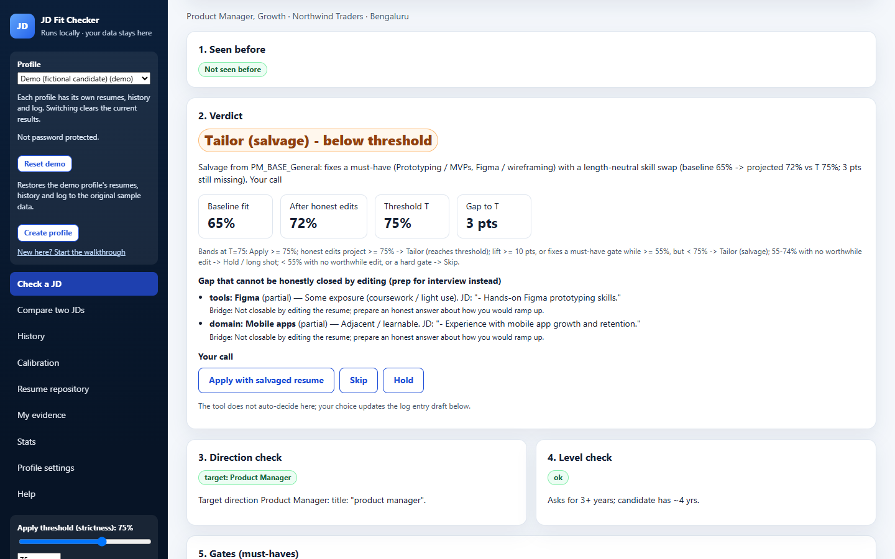
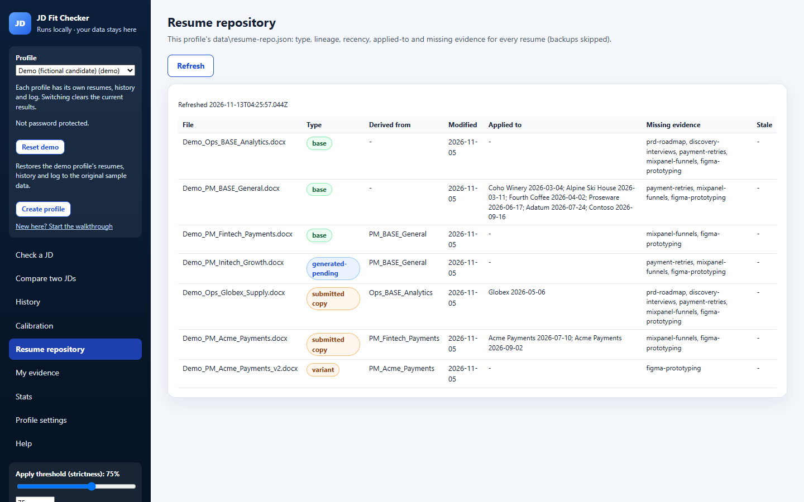
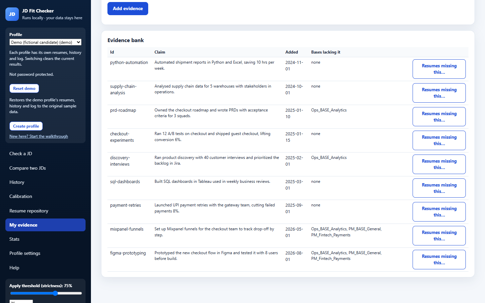
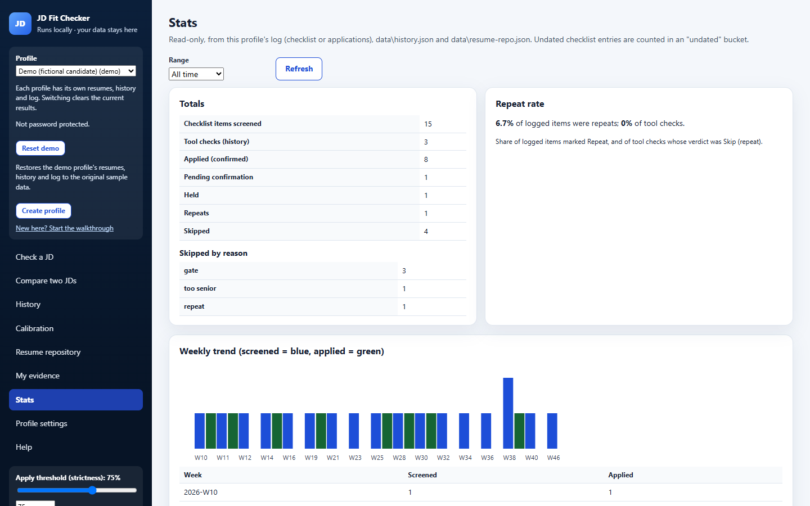
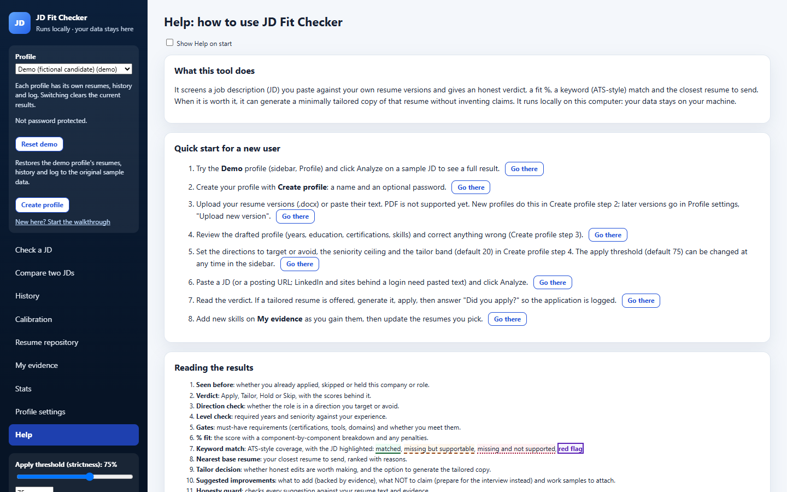
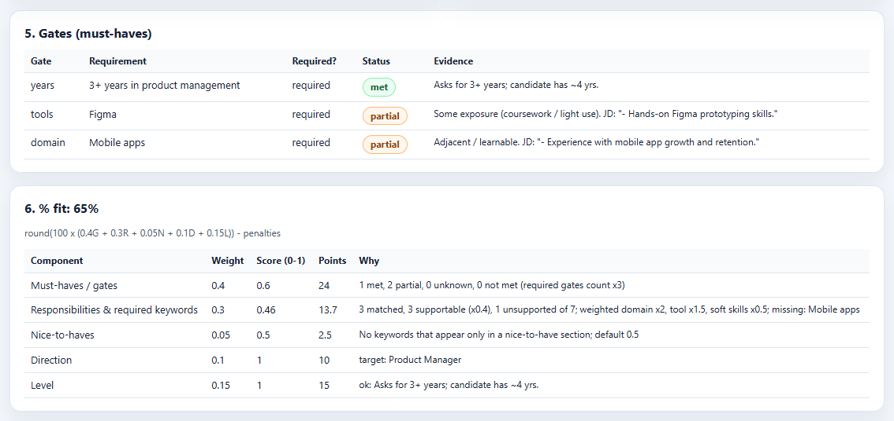
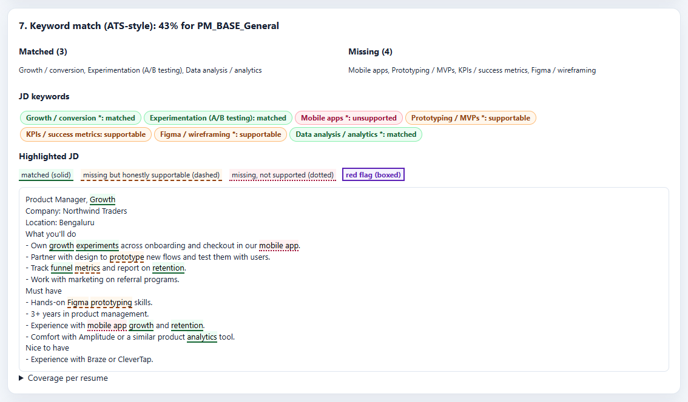
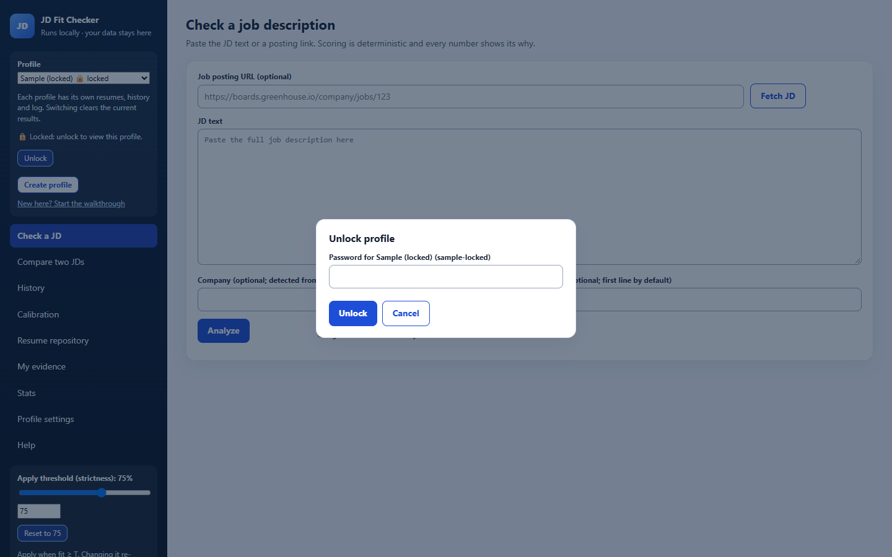

# JD Fit Checker

Check a job description against your own resumes and get an honest, explainable verdict before you spend time applying.

- A clear verdict (Apply, Tailor, Hold or Skip) with a fit %, must-have gates and an ATS-style keyword match, where every number shows why.
- The closest of your resumes to send, plus an optional, minimally tailored copy that never invents claims.
- Interview prep, a ready-made log entry, application history and stats, all kept per profile.
- Runs locally on your own computer. No account, no cloud, no AI/LLM service and no API keys. Zero npm dependencies (only Node.js itself).

Your resumes never leave your computer. The only outbound request the tool makes is fetching a job-posting URL that you type in yourself.



*Example: a salvage verdict on the fictional Demo profile. Honest edits lift the fit from 65% to 72%, still 3 points below the 75% threshold, so the tool shows the gap and leaves the call to you.*

## Quick start (no typing needed)

1. Install [Node.js](https://nodejs.org/en/download) (LTS, version 22 or newer). One time only. The launcher tells you if it is missing.
2. Download the tool: green Code button > Download ZIP.
3. Unzip it. Windows: right-click the ZIP > Extract All > Extract. (Double-clicking a ZIP only previews it.)
4. Open the extracted folder and double-click the launcher for your system:
   - Windows: `Start JD Fit Checker.cmd`
   - macOS: `Start JD Fit Checker.command` (the first time: right-click > Open > Open)
   - Linux: `start.sh`
5. Your browser opens JD Fit Checker. Keep the small window that opened alongside it; close that window when you are done.

The first start on Windows or macOS may show a one-time security prompt because the file came from the internet. [Running the tool](#running-the-tool) shows exactly what to click.

## Table of contents

1. [Features](#features)
2. [Requirements](#requirements)
3. [Installation](#installation)
4. [Running the tool](#running-the-tool)
5. [First-time walkthrough](#first-time-walkthrough)
6. [Understanding the results](#understanding-the-results)
7. [Profiles, passwords and privacy](#profiles-passwords-and-privacy)
8. [Updating to a new version](#updating-to-a-new-version)
9. [Troubleshooting](#troubleshooting)
10. [FAQ](#faq)
11. [For developers and advanced users](#for-developers-and-advanced-users)
12. [Privacy statement](#privacy-statement)
13. [Contributing](#contributing)
14. [License](#license)

## Features

### Screening results (in the order they appear)

1. Seen before: whether you already applied to, skipped or held this company or role.
2. Verdict: Apply, Tailor, Hold or Skip, with the baseline and projected scores behind it.
3. Direction check: whether the role is in a direction you target, are neutral on or avoid.
4. Level check: required years and seniority against your experience, plus red flags.
5. Gates: must-have certifications, tools and domains, and whether you meet them.
6. % fit: the score with a component-by-component breakdown and any penalties.
7. Keyword match: ATS-style coverage, with the job description highlighted by colour.
8. Nearest base resume: your closest resume to send, ranked with reasons.
9. Tailor decision: whether honest edits are worth making, with a button to generate the tailored copy.
10. Suggested improvements: what to add (backed by your evidence), what not to claim, and work samples to attach.
11. Honesty guard: every suggestion checked against your resume text and evidence.
12. Interview prep: likely questions with honest bridges for the gaps.
13. Log entry draft: a ready-made line for your application log.

### Honest tailoring and resume generation

- Edits are deliberately small: at most one skill swap from your evidence and one closing-sentence swap.
- Edits are computed once, in a single pass. The tool never keeps editing to chase the threshold.
- A built-in generator writes a new .docx file next to your resumes. It never overwrites a file and never edits your base resume or a resume you already submitted.
- A one-page check warns when the new file may run over one page. It is a line-count estimate, so open the file to confirm.
- Microsoft Word is not needed to run the tool or to generate files.

### Profiles and privacy

- Separate profiles, each with its own resumes, rules, history and log. A fictional Demo profile is included to try things out.
- An optional password per profile that locks it and encrypts the tool's own files for it.
- All data lives in a profile folder in your user folder, outside the tool folder.

### Resume repository and evidence

- Resume repository: every resume with its type (base, submitted copy, variant), lineage, staleness and recency.
- My evidence: add skills and achievements you can honestly claim. The tool then offers a pick list (with Select all) to update the resumes that lack them. Submitted copies are never edited: when included, they are copied once into a new `_v2` file.



*Resume repository: which resume is a base, a submitted copy or a variant, where it was sent and what evidence it lacks.*



*My evidence: the honest claims the tool may use, and which base resumes do not mention them yet.*

### History, stats, compare and calibration

- History: your last 500 checks in this profile.
- Stats: screening and application counts, trends and the most common gaps, for the last 7 days, 30 days or all time.
- Compare two JDs: two postings side by side.
- Calibration: sample roles scored against expected results, so you can see how the scoring behaves.



*Stats: what you screened and applied to, why roles were skipped, and the weekly trend.*

### Built-in Help

- A Help tab with a step-by-step walkthrough. Each step has a "Go there" button that takes you to the right place.
- It also explains each result card, shows a verdict table at your current threshold, and lists troubleshooting tips.
- Help opens automatically on your first visit and for a new profile. "Show Help on start" in Help and "New here? Start the walkthrough" in the sidebar bring it back.

## Requirements

| Item | What you need |
|---|---|
| Node.js | Version 22 or newer. The current LTS ("Long Term Support") release from nodejs.org is the right choice. |
| Browser | Microsoft Edge, Google Chrome or Mozilla Firefox (a recent version). |
| Operating system | Windows 10 or 11 is the main target. macOS and Linux work too; see the notes in each section. |
| Disk space | Negligible. The tool is under 1 MB; your profiles grow with the resumes you upload. |
| Microsoft Word | Not required. Your resumes must be .docx files, which Word, LibreOffice, Google Docs or Pages can all save. |
| Internet | Only needed to download the tool and to fetch job postings by URL. Pasting job text works offline. |

Why Node.js 22: the built-in resume generator and the test runner rely on features that older versions lack.

## Installation

You do this once. It takes about 10 minutes.

### Step 1: install Node.js

1. Go to [the Node.js download page](https://nodejs.org/en/download).
2. Download the LTS installer for your system (Windows Installer `.msi`, or macOS Installer `.pkg`).
3. Run it and accept the defaults. On Windows you do not need the optional "Tools for Native Modules".
4. That's it. You do not need to open a terminal to check anything: the launcher checks that Node.js is installed and new enough every time it starts. If it is missing or too old, the launcher says so in plain words and opens the download page for you.
   - Linux: you can also install Node.js with your package manager or [nvm](https://github.com/nvm-sh/nvm), as long as the version is 22 or newer.

### Step 2: get the tool

Pick one option. Option A is the simplest.

#### Option A: Download ZIP (no extra software)

1. On the project's GitHub page, click the green Code button, then Download ZIP.
2. Find the downloaded file (usually in your Downloads folder). It is named `resume-jd-fit-checker-main.zip`.
3. Windows only, optional but recommended: right-click the ZIP, choose Properties, tick Unblock at the bottom of the General tab (if you see it), and click OK. This stops Windows from showing a security warning the first time you start the tool. If there is no Unblock box, skip this step.
4. Unzip (extract) it:
   - Windows: right-click the ZIP, choose Extract All, then Extract. Do not just double-click the ZIP: that only shows a preview of what is inside, and the tool cannot run from the preview.
   - macOS: double-click the ZIP. Finder extracts it next to the ZIP (Safari may already have done this for you).
   - Linux: right-click the ZIP and choose Extract Here.
5. You now have a folder named `resume-jd-fit-checker-main`. Open it and check that you can see `Start JD Fit Checker.cmd`, `server.cjs`, `index.html` and folders such as `lib` and `defaults`. If you only see one folder inside, open that one: that is the tool folder.
6. Move the folder somewhere permanent, for example your Documents folder: `C:\Users\<you>\Documents\resume-jd-fit-checker-main`. You can rename it if you like (for example to `jd-fit-checker`). Folder names with spaces are fine.

#### Option B: GitHub Desktop

1. Install [GitHub Desktop](https://desktop.github.com/) and sign in (a free GitHub account is needed for this option only).
2. On the project's GitHub page, click the green Code button, then Open with GitHub Desktop.
3. Choose a local path, for example your Documents folder, and click Clone.
4. Later, click Fetch origin, then Pull to update.

#### Option C: git clone

1. On the project's GitHub page, click the green Code button and copy the HTTPS URL.
2. In a terminal, go to the folder where you want the tool and clone it (paste the URL you copied in place of `<URL>`):

   ```
   cd ~/Documents
   git clone <URL>
   cd resume-jd-fit-checker
   ```

   On Windows PowerShell, `cd ~/Documents` also works.

### Step 3: nothing else to install

There is no `npm install` step. The tool uses only what comes with Node.js.

## Running the tool

You start JD Fit Checker by double-clicking a launcher file in the tool folder. You never need to type a command.

| System | Double-click this file |
|---|---|
| Windows 10 / 11 | `Start JD Fit Checker.cmd` (it may show as "Start JD Fit Checker" with a gear icon, type "Windows Command Script") |
| macOS | `Start JD Fit Checker.command` |
| Linux | `start.sh` |

What happens when you double-click it:

1. A small window opens with the title "JD Fit Checker". It checks that Node.js is installed (version 22 or newer) and that the tool's files are next to it.
2. It starts the tool and your browser opens the page by itself a moment later.
3. The window shows a line like this one (the port may differ):

   ```
   JD Fit Checker is running at http://127.0.0.1:4317 . Keep this window open while you use it. Close this window (or press Ctrl+C) to stop.
   ```

4. Use the tool in the browser. Leave the small window open (you can minimise it). It is the tool's engine: if you close it, the page stops working.
5. When you are done, close the small window. That stops the tool. Your data is saved as you go.

Good to know:

- Already running? If you double-click the launcher while the tool is already running, it does not start a second copy. It opens the browser on the running one and says "JD Fit Checker is already running".
- Port in use? The tool uses port 4317. If another program already uses it, the launcher picks the next free port (4318, 4319, ... up to 4330) and opens the browser on that address. Use the address shown in the window.
- Bookmark the page if you like, but the bookmark only works while the launcher window is open. Start the launcher first, then use the bookmark.
- Use the launcher inside the extracted folder. If it says "Please extract (unzip) the folder first", you started it from inside the ZIP preview; see [Installation](#installation), Step 2.
- If Node.js is missing or too old, the window says so and opens the Node.js download page. Install it, then double-click the launcher again.

### Windows: first start

1. Open the extracted tool folder in File Explorer.
2. Double-click `Start JD Fit Checker.cmd`.
3. The first time only, Windows may ask whether to run a file downloaded from the internet. This is normal for any script that is not from the Microsoft Store:
   - "Windows protected your PC" (blue SmartScreen box): click More info, then Run anyway.
   - "Open File - Security Warning" ("The publisher could not be verified"): click Run. Untick "Always ask before opening this file" if you want it to stop asking.
   - To avoid both prompts, unblock the ZIP before extracting it (right-click the ZIP > Properties > tick Unblock > OK, then Extract All again).
4. Firewall: a Windows Defender Firewall prompt is not expected, because the tool only listens on 127.0.0.1 (your own computer) and is not reachable from the network. If one ever appears, you can click Cancel; the tool keeps working on this computer.

Optional, a desktop shortcut: right-click `Start JD Fit Checker.cmd`, choose Show more options (Windows 11), then Send to > Desktop (create shortcut). Double-click the shortcut from then on. Keep the tool folder where it is, or make the shortcut again after moving it.

### macOS: first start

1. Open the extracted tool folder in Finder.
2. The first time only: right-click (or Control-click) `Start JD Fit Checker.command`, choose Open, then click Open in the dialog. macOS asks this once because the file is not from the App Store (Gatekeeper). From then on, a normal double-click works.
   - On newer macOS versions (15 Sequoia and later) there may be no Open button. Click Done, open System Settings > Privacy & Security, scroll down to the message about "Start JD Fit Checker.command" and click Open Anyway, then confirm.
3. A Terminal window opens and the browser follows. Keep the Terminal window open while you use the tool; close it (or press Ctrl+C in it) to stop.

If macOS says the file "could not be executed because you do not have appropriate access privileges" (or "permission denied"), the file lost its "can run" flag on the way (this happens with files uploaded through the GitHub website). Fix it once:

1. Open Terminal (Cmd+Space, type `Terminal`, press Enter).
2. One-time fix: type `chmod +x ` (with a space at the end), drag `Start JD Fit Checker.command` from Finder into the Terminal window, and press Enter.
3. Close Terminal and double-click the launcher again. You never need to repeat this for that folder.

Optional: drag the launcher to the Dock (right side, next to the Bin) or make an alias on the Desktop (Option+Cmd drag) for one-click starts.

### Linux: first start

1. Open the extracted tool folder in your file manager.
2. Double-click `start.sh` and choose Run (or Run in Terminal) if asked.
3. If it opens in a text editor instead: right-click `start.sh` > Properties > Permissions, tick "Allow executing file as program", close the dialog, then right-click `start.sh` > Run as a Program. Some file managers only run scripts from a terminal; then right-click inside the folder, choose Open in Terminal and run `bash start.sh`.

### Advanced: manual start (optional)

You do not need this if the launcher works for you. It is for people who prefer a terminal, or for scripting.

1. Open a terminal in the folder that contains `server.cjs`:
   - Windows: open the tool folder in File Explorer, click the address bar, type `powershell` and press Enter.
   - macOS: open Terminal, type `cd ` (with a space), drag the tool folder into the window, press Enter.
   - Linux: right-click inside the folder and choose Open in Terminal.
2. Start the server:

   ```
   node server.cjs
   ```

   The first time, you should see something like this (your profile store path will differ):

   ```
   Installed the demo profile (synthetic data).
   JD Fit Checker running at http://127.0.0.1:4317  (profile store: C:\Users\<you>\.jd-fit-checker)
     profiles: demo
   ```

   On later starts the first line is not shown, and the `profiles:` line lists every profile you have, with `(protected)` after the ones that have a password.
3. Open [http://127.0.0.1:4317](http://127.0.0.1:4317) in Edge, Chrome or Firefox. `http://localhost:4317` also works.
4. Stop it with Ctrl+C in the terminal, or close the terminal window.

The manual start uses exactly the port you give it and does not open the browser or look for a free port. If the port is busy it stops with `EADDRINUSE`.

#### Using a different port

The tool uses port 4317 by default. To use another port (for example 4400), set the `PORT` environment variable when you start it. The launchers respect `PORT` too (they try that port first).

Windows PowerShell:

```powershell
$env:PORT=4400; node server.cjs
```

macOS / Linux:

```bash
PORT=4400 node server.cjs
```

Then open `http://127.0.0.1:4400`. In PowerShell the setting lasts until you close that window.

### Where your data is stored (the profile store)

Profiles are stored outside the tool folder, in a hidden folder in your user folder:

| System | Default location |
|---|---|
| Windows | `C:\Users\<you>\.jd-fit-checker\` (the same as `%USERPROFILE%\.jd-fit-checker\`) |
| macOS | `/Users/<you>/.jd-fit-checker/` |
| Linux | `/home/<you>/.jd-fit-checker/` |

The launcher window shows the exact path (after "profile store:") when it starts. Advanced: to use a different folder (for example a folder on another drive), set the `JDFC_HOME` environment variable and start the tool from that terminal (the manual start, or the launcher started from the same terminal).

Windows PowerShell:

```powershell
$env:JDFC_HOME="D:\JobSearch\jdfc-data"; node server.cjs
```

macOS / Linux:

```bash
JDFC_HOME="$HOME/JobSearch/jdfc-data" node server.cjs
```

You can combine both, for example `$env:PORT=4400; $env:JDFC_HOME="D:\JobSearch\jdfc-data"; node server.cjs`. Remember to set `JDFC_HOME` the same way every time, or the tool will look in the default folder and not see your profiles.

On macOS, folders starting with a dot are hidden in Finder. Press Cmd+Shift+. (period) to show them.

## First-time walkthrough

The Help tab in the tool has the same steps with "Go there" buttons.



*The built-in Help walkthrough. Each "Go there" button jumps to the right place in the tool.*

### 1. Start the tool and try the Demo profile

1. Double-click the launcher in the tool folder (`Start JD Fit Checker.cmd` on Windows, `Start JD Fit Checker.command` on macOS, `start.sh` on Linux; see [Running the tool](#running-the-tool)). The browser opens the tool. Keep the launcher window open.
2. In the sidebar, under Profile, select Demo. It is a fictional candidate with sample resumes, history and log.
3. On Check a JD, paste any job description (a real posting you found online is fine) and click Analyze.
4. Scroll through the results to see what the tool produces.
5. "Reset demo" in the sidebar restores the demo to its original state at any time.

### 2. Create your profile

1. Click Create profile in the sidebar.
2. Step 1 of 5, name and password:
   - Profile id: 2 to 32 characters, using lowercase letters `a-z`, digits `0-9` and dashes `-`, starting with a letter or digit. Example: `my-search`.
   - Display name: anything you like.
   - Password: optional. If you set one, your profile's data is encrypted on disk. There is no password recovery: a forgotten password means resetting the profile and losing that data.

### 3. Upload your resumes

Step 2 of 5:

- Upload one or more resume versions as .docx files (several at once is fine). Each file can be up to 5 MB.
- PDF files are refused. Open the PDF in Word or another editor and save it as .docx, or paste the resume text into the box instead (one paragraph per line).
- Give the files a role family, for example `pm`, `analyst` or `ops`. Within a family, the newest upload becomes the default "base" resume; older ones are kept as history.
- Click Upload, then Continue to review.

### 4. Review the draft profile

Step 3 of 5: the tool drafts your facts from the resume text: name, total years of experience, current role, titles, education, certifications, tools, domains and metrics. Every field is editable. Keep only what you can back up in an interview, and add phrases you must never claim (for example `people management`).

### 5. Set directions, seniority and strictness

Step 4 of 5:

- Directions: mark each type of role as target, neutral or avoid.
- Seniority ceiling: the highest "minimum years of experience" a job may ask for before it counts as too senior.
- Apply threshold: the fit % at which you apply as-is. Default 75. You can change it any time with the slider in the sidebar.
- Tailor band: how many points below the threshold are still worth tailoring for. Default 20.
- Click Save profile.

Step 5 of 5 is optional: paste an existing application log (CSV with a header row such as `date, company, role, status, resume, fit`, or a markdown checklist) and click Import. Duplicates by company, role and date are skipped. Click Finish to switch to your new profile.

### 6. Analyze a job description

1. Go to Check a JD.
2. Either paste the full job text into the JD text box, or paste the posting URL and click Fetch JD.
   - Fetching works for many public career pages.
   - LinkedIn and sites behind a login block automated reads. The tool then asks you to paste the text instead: select the job description on the page, copy it, and paste it.
3. Company and role title are optional; the tool detects them from the text.
4. Click Analyze.

### 7. Read the results and generate a tailored resume

1. Start with the Verdict card, then look at Gates and % fit to see why. The next section explains every card.
2. If the Tailor decision card offers it, click Generate resume. The built-in generator creates a new .docx next to your resumes and gives you a download link. Your base resume is not touched.
3. Open the new file and check it, including the one-page warning (it is an estimate).
4. After you apply, answer "Did you apply?" (applied, pending or skip). That logs the application, so the tool can warn you about repeats later.

### 8. Keep your evidence up to date

1. When you gain a new skill or result, go to My evidence and add it: a short id, the exact claim wording, and the keyword ids it supports.
2. The honesty guard checks it, then the pick list shows which resumes lack it. Select the ones to update (or Select all), preview, and confirm.
3. Later resume versions go in Profile settings, "Upload new version".

## Understanding the results

### The result cards

| # | Card | What it tells you |
|---|---|---|
| 1 | Seen before | Repeat (already applied), same company but new role, skipped or held before, pending, or not seen before. |
| 2 | Verdict | Apply, Tailor, Hold or Skip, with the baseline fit, projected fit after honest edits, and the reason. |
| 3 | Direction check | Whether the role is in a target, neutral or avoided direction, and why. |
| 4 | Level check | Required years and seniority against yours, plus red flags. |
| 5 | Gates (must-haves) | Each requirement, whether it is required or preferred, and whether you meet it. "(hard)" marks a gate that forces Skip. |
| 6 | % fit | The score broken into components (must-haves, responsibilities and keywords, and so on) with penalties. |
| 7 | Keyword match | ATS-style coverage, with the JD text highlighted (see the colour legend below). |
| 8 | Nearest base resume | Your resumes ranked by closeness, with reasons, and the one to send. |
| 9 | Tailor decision | Whether honest edits are worth it, baseline vs projected fit vs your threshold, and the Generate button. |
| 10 | Suggested improvements | What to add (backed by evidence), what not to claim (prepare for the interview instead), and work samples. |
| 11 | Honesty guard | Whether every suggestion passes the check against your resume and evidence. |
| 12 | Interview prep | Likely questions with honest bridges for gaps. |
| 13 | Log entry draft | A line for your log, with a Copy button. |



*Gates and % fit: every requirement with its evidence, and how each component adds up to the score.*

### Colour legend

| Colour | In the keyword highlights | In status labels |
|---|---|---|
| Green (solid underline) | Matched: the keyword is in your resume | Met, or a good outcome |
| Amber (dashed underline) | Missing but supportable from your evidence | Partial, or needs a decision |
| Red (dotted underline) | Missing and not supported | Not met, or Skip |
| Violet (outlined) | Red flag in the job description | |
| Blue | | Information only (for example, unknown) |



*Keyword match: green is matched, amber is missing but supportable from your evidence, red is missing and not supported.*

### Verdicts

T is your apply threshold (default 75) and the band is your tailor band (default 20). At the defaults, the tailor floor is 55 (T minus band).

| Verdict | When |
|---|---|
| Apply as-is | Fit is at or above T and no fix is needed. |
| Tailor (reaches threshold) | Honest edits bring the projected fit to T or above. |
| Tailor (salvage) | Fit stays below T, but the edits give a real benefit: they add at least 10 points, or they fix a must-have from an explicit "must have" line while the fit is at or above the tailor floor. The tool shows the gap it cannot honestly close, and you decide (apply with the salvaged resume, skip or hold). |
| Hold / long shot | Fit between the tailor floor and T minus 1 (55 to 74 at the defaults) with no worthwhile edit. You decide. |
| Skip | Fit below the tailor floor with no worthwhile edit, or a hard gate fails at any threshold: too senior, wrong direction, or a required certification, specialist platform, tool or domain you do not hold. |
| Skip (repeat) | You already applied to this role. |

Changing the threshold slider (40 to 95, in steps of 5) re-scores the current job instantly without fetching it again. The setting is saved in your browser.

Scores are deliberately strict, like a recruiter's first screen. A 60% is not a bad resume; it means a careful reader would see gaps. Honest edits are computed once: the tool never repeats edits to reach the threshold, and never inflates a score.

## Profiles, passwords and privacy

### Where your data lives

Each profile is a folder in the profile store: `<store>\profiles\<id>\`, where `<store>` is `C:\Users\<you>\.jd-fit-checker` by default (see [Where your data is stored](#where-your-data-is-stored-the-profile-store)). It holds:

- your uploaded resumes (`resumes\`) and generated tailored copies,
- your settings (`config\`): profile facts, rules, evidence,
- your data (`data\`): history, resume repository, application log.

The tool folder itself contains only code, generic rules and the demo. Nothing you upload is stored in it.

### Password lock

- Set a password when you create a profile, or later in Profile settings, "Set / change password". The Demo profile cannot have a password.
- Your password is never stored. The tool keeps only a scrypt hash of it.
- While protected, the tool's own files for that profile (settings, history, repository, log, calibration samples) are encrypted on disk with AES-256-GCM, using a key derived from your password.
- Use Unlock in the sidebar to open it. It locks again after 30 minutes without activity, when you click Lock, or when the server restarts.



*A protected profile stays locked until you enter its password.*
- After 5 wrong passwords, unlocking is paused for 60 seconds, doubling with each further lockout up to 15 minutes.

### Security model and limits

Be clear about what the password does and does not do:

- A forgotten password cannot be recovered, and neither can the encrypted data. The only way forward is Reset profile.
- It does not protect against someone with administrator access to the same computer.
- Not everything is encrypted: uploaded .docx resumes in `resumes\`, generated files, temporary files in `tailor-runs\` and `reports\`, and any files you linked from outside the profile folder stay unencrypted.
- Reset profile (Profile settings, type the profile id to confirm) permanently deletes the profile's settings, history, repository, log and calibration samples, and removes the password. Resume .docx files are left in place.
- Reset also replaces `config\paths.json` with the empty template's version. If you edited it (for example to point at resume files elsewhere), keep a copy outside the store before setting a password, and copy it back after a reset.

### Back up or move to another computer

1. Stop the tool (close the launcher window).
2. Copy your profile folder `<store>\profiles\<id>\` to a USB stick or backup location. To back up everything, copy the whole `.jd-fit-checker` folder.
3. On the other computer, install Node.js and the tool, start it once with the launcher (this creates the store), close the launcher window, then copy the profile folder into `<store>\profiles\`.
4. Start the tool again with the launcher. A password-protected profile keeps the same password.

If you edited `config\paths.json` to use absolute paths, update them on the new computer.

### Delete a profile

There is no delete button. Stop the tool (close the launcher window), then delete the folder `<store>\profiles\<id>\`. This cannot be undone.

### Reset the demo

Click Reset demo in the sidebar (shown when the Demo profile is selected). If you delete the demo folder, it is re-created the next time the server starts.

## Updating to a new version

Your profiles live outside the tool folder, so updating the tool does not touch them.

1. Stop the tool: close the JD Fit Checker launcher window (or press Ctrl+C in it).
2. Get the new version:
   - Download ZIP: download the new ZIP, unblock it on Windows (right-click > Properties > Unblock, if shown), extract it, then replace the old tool folder with the new one (or delete the old folder's contents and copy the new contents in).
   - GitHub Desktop: click Fetch origin, then Pull.
   - git: run `git pull` in the tool folder.
3. Start it again by double-clicking the launcher in the new folder. If you made a desktop shortcut and the folder moved, make the shortcut again. On macOS the one-time Open / `chmod +x` steps may be needed again for the new copy.
4. In the browser, press Ctrl+F5 (Cmd+Shift+R on macOS) to load the new page.

## Troubleshooting

| Problem | What to do |
|---|---|
| Double-clicking the launcher shows "Node.js is not installed" or "Your Node.js is too old" | Install the LTS version from the page the launcher opened ([nodejs.org/en/download](https://nodejs.org/en/download)), then double-click the launcher again. If it still says Node.js is missing right after installing, restart the computer once. |
| The launcher says "Please extract (unzip) the folder first" | You opened the ZIP preview instead of the extracted folder. Close the window, right-click the ZIP > Extract All > Extract, open the extracted folder and double-click the launcher there. |
| Windows: "Windows protected your PC" or "Open File - Security Warning" | One-time prompt for files from the internet. Click More info > Run anyway, or Run. To avoid it, right-click the ZIP > Properties > Unblock before extracting. See [Windows: first start](#windows-first-start). |
| Windows: double-clicking `Start JD Fit Checker.cmd` opens Notepad or another editor | The file type was changed on this computer. Right-click the file and choose Open (not Edit). |
| Windows: the window flashes and closes | Start it again; if it keeps closing, use the [manual start](#advanced-manual-start-optional) once to read the error message. |
| macOS: "cannot be opened because it is from an unidentified developer" / "Apple could not verify..." | Right-click the launcher > Open > Open (or System Settings > Privacy & Security > Open Anyway). See [macOS: first start](#macos-first-start). |
| macOS: "could not be executed because you do not have appropriate access privileges" or "permission denied" | The one-time `chmod +x` fix in [macOS: first start](#macos-first-start). |
| Linux: `start.sh` opens in a text editor | Allow it to run as a program; see [Linux: first start](#linux-first-start). |
| The launcher says "JD Fit Checker is already running" | It is: another launcher window (perhaps minimised) is running it, and the browser was opened on it. Use that copy, or close its window first to restart. |
| The launcher says the port was used by another program | Nothing to fix: it chose the next free port. Use the address shown in the window (for example `http://127.0.0.1:4318`). |
| "Ports 4317-4330 are all in use by other programs" | Close some programs or restart the computer, then start again. |
| Manual start: `node : The term 'node' is not recognized` / `command not found: node` | Node.js is not installed, or the terminal was opened before installing it. Install it, open a new terminal, and try again. |
| Manual start: `Cannot find module ...\server.cjs` | The terminal is not in the tool folder. Use the launcher instead, or open the terminal from the folder that contains `server.cjs`. |
| Manual start: `Error: listen EADDRINUSE: address already in use 127.0.0.1:4317` | Another copy is already running, or another program uses the port. Use the launcher (it picks a free port), or set another port: `$env:PORT=4400; node server.cjs`. |
| The page will not load ("can't reach this page") | Check the launcher window is still open and shows "JD Fit Checker is running at ...". Use the exact address shown there (http, not https, and the same port). |
| A button seems to do nothing | Read the message right under the button. "Profile is locked": click Unlock in the sidebar. "Paste a JD or a posting URL": the JD text box is empty. |
| "Analyze timed out after 60 s" or "Fetch timed out after 30 s" | The tool may be busy or stopped. Look at the launcher window; if it has closed, double-click the launcher again, then try again. For Fetch, pasting the text always works. |
| "Part of the page failed to load" banner | Press Ctrl+F5 to reload fully. Other controls still work. Details are in the browser console (press F12, then Console). |
| Odd behaviour, buttons covered or not responding | A browser extension (password manager, ad blocker, page translator) may interfere. Try a private / InPrivate window, or another browser. |
| Windows Defender Firewall asks about Node.js | Not expected, because the tool listens only on 127.0.0.1 (your own computer). If it does appear, click Cancel (or allow Private networks only); the tool does not need network access to work. |
| Fetch JD fails on a work or school network | A proxy or firewall may block outbound requests from Node.js. Paste the job text instead. |
| Fetch says to paste the text instead | The site needs a login or blocks automated reads (LinkedIn does). Copy the job description from the page and paste it. |
| "PDF not supported yet, export to .docx or paste text" | Save the resume as .docx in Word, LibreOffice or Google Docs (File, Download, Microsoft Word), or paste the text. |
| A .docx is not read correctly or the draft is empty | Open it in Word or LibreOffice and use Save As, Word Document (.docx). Files from some online converters or very old formats (.doc) are not supported. Pasting the text also works. |
| "The file is larger than 5 MB" | Remove large images from the resume, or paste the text instead. |
| Changes do not show after an update | Close the launcher window, double-click the launcher in the new folder, then press Ctrl+F5 in the browser. |
| My profiles disappeared | You probably started the tool with a different `JDFC_HOME` (or without it). Check the "profile store" path shown in the launcher window at start-up. |

## FAQ

Does it send my resume anywhere?
No. Everything runs on your computer. The only outbound request is fetching a job-posting URL you enter.

Does it use ChatGPT or another AI service?
No. Scoring is rule-based and deterministic: the same inputs always give the same result, and every number shows its reason.

Why is my fit lower than I expected?
Scoring is strict, like a recruiter's first screen. If it is too strict for you, lower the apply threshold in the sidebar.

Why won't it add a skill I have?
The honesty guard only uses your resume text and your evidence. Add the skill on My evidence first.

Can I use PDF resumes?
Not yet. Save them as .docx or paste the text.

Do I need Microsoft Word?
No. Word, LibreOffice, Google Docs or Pages can all produce .docx files, and the tool generates .docx files itself.

Can I use it on another computer?
Yes. Install the tool there and copy your profile folder across (see [Back up or move to another computer](#back-up-or-move-to-another-computer)).

Can other people on my network open it?
No. The server listens only on 127.0.0.1 and rejects requests addressed to any other host name.

## For developers and advanced users

### Project layout

```
Start JD Fit Checker.cmd       Windows double-click launcher (batch, CRLF)
Start JD Fit Checker.command   macOS double-click launcher (bash, LF)
start.sh                       Linux launcher (bash, LF)
server.cjs          HTTP server (Node built-ins only), binds to 127.0.0.1
index.html          the whole UI (no build step)
lib/                scoring, rules, keywords, gates, advice, honesty guard, .docx read/write, profiles, auth
defaults/           rules.json (generic rules) and keywords.json (keyword taxonomy)
profiles-seed/      _template (empty new profile) and demo (fictional candidate)
scripts/            command-line tools (calibration, password, packaging, smoke tests)
test/               automated tests (node:test)
```

### Running the tests

From the tool folder:

```
node --test "test/*.test.cjs"
```

This needs Node.js 22 or newer (the quoted glob is expanded by Node itself, so it works the same in PowerShell, cmd and bash). The tests use temporary profile stores, so your profiles are not touched. One suite runs per-profile test folders (`<store>/profiles/<id>/tests/`) when a profile has one; on a normal install there is none, so that suite is reported as skipped. A protected profile's suite needs `JDFC_PASSWORD` set.

### Scripts

Scripts that work on a profile take `--profile <id>`; otherwise they use the `JDFC_PROFILE` environment variable, otherwise `demo`. For a password-protected profile they read the password from `JDFC_PASSWORD`.

```
node scripts/calibrate.cjs --profile demo [--threshold 75] [--verbose]   # calibration table; exit 0 when all fixtures pass
node scripts/explain.cjs [<fixture-id>] --profile <id>                    # score breakdown for a profile's fixtures
node scripts/set-password.cjs <id>                                         # set or change a password (hidden prompt)
node scripts/test-profile.cjs <id>                                         # run one profile's own test folder
node scripts/hash-inputs.cjs --profile <id>                                # SHA-256 of a profile's resumes and linked files
node scripts/smoke.cjs --profile <id> [--expect-base <name>] <public-job-url> <login-walled-job-url>   # HTTP smoke test
node scripts/package-public.cjs [--out <dir>]                              # build a shareable copy + zip
```

- `set-password.cjs` asks for the current password first when one is set. Restart a running server afterwards. The demo cannot be protected.
- `package-public.cjs` writes `dist/jd-fit-checker-public/` and `dist/jd-fit-checker-public.zip`. It copies an allow-list of files only and refuses (exit 1, output removed) if a file matches a deny-list of personal terms, is identical to a file in a non-demo profile, or sits under a `config`, `data`, `dist` or `tests` path outside `profiles-seed`.

### Browser smoke test (optional)

`scripts/ui-smoke.cjs` drives a real headless Microsoft Edge (DevTools protocol) and/or Firefox (WebDriver BiDi) with fresh temporary browser profiles. It starts its own server on port 4319 with a temporary profile store, clicks through the main scenarios (demo, locked profile, fresh profile, empty input, tab switching, Help tab, injected elements with generic ids, failing storage) and the 60 s / 30 s request timeouts, then cleans everything up. A browser that is not installed is skipped.

```
node scripts/ui-smoke.cjs [--browser edge|firefox|all] [--port 4319] [--skip-timeouts] [--keep]
node scripts/ui-smoke.cjs --attach http://127.0.0.1:4317   # read-only probe of a running server
```

Use `--edge <path>` or `--firefox <path>` if the browser is not found automatically. Exit code 0 means every scenario passed, 1 a failure, 2 no browser could run.

### Regenerating the README screenshots

`scripts/capture-screenshots.cjs` recreates the images in `docs/` from the Demo profile only. It starts its own server on port 4471 with a temporary, empty profile store, drives headless Microsoft Edge at 1440x900, refuses any view whose visible text matches the deny-list or your user name, and cleans everything up. Look at every image before publishing it.

```
node scripts/capture-screenshots.cjs [--out docs] [--port 4471] [--edge <path>]
```

### Environment variables

| Variable | Default | Purpose |
|---|---|---|
| `PORT` | `4317` | Port the server listens on (always on 127.0.0.1). |
| `JDFC_HOME` | `<home>/.jd-fit-checker` | Profile store folder. |
| `JDFC_PROFILE` | `demo` | Default profile for scripts. |
| `JDFC_PASSWORD` | not set | Password used by scripts and the profile test suite for a protected profile. The server ignores it. |
| `JDFC_IDLE_MS` | `1800000` (30 min) | Idle time before an unlocked profile locks. |
| `JDFC_LAUNCHER` | not set | Set to `1` by the launchers. The server then tries `PORT` and the next 13 ports, reports a copy that is already running instead of starting a second one, and opens the browser once it is listening (`lib/launch.cjs`). Without it the server behaves as a plain `node server.cjs`. |
| `JDFC_NO_BROWSER` | not set | `1` = the launchers do not open a browser (for testing). |
| `JDFC_LAUNCHER_TEST` | not set | `1` = the launchers do not wait for a key press or pause at the end (for testing). |

### Profile folder layout

```
<store>/profiles/<id>/
  profile.meta.json               id, name, kind (demo | user), protected flag, password hash + salts (never the password)
  config/profile.json             years, education, certifications, tools/domains, evidence bank, forbidden claims, templates
  config/rules.json               optional override, deep-merged over defaults/rules.json (arrays replace)
  config/keywords-overrides.json  evidence links onto the default taxonomy + extra keywords
  config/bases.json               optional base resumes (closing sentence, swap slots)
  config/evidence-added.json      evidence added from My evidence
  config/paths.json               resume folder, file prefix, optional links, generator, log
  data/history.json, resume-repo.json, applications.json, uploads.json
  fixtures/jds/                   optional calibration fixtures
  resumes/                        uploaded and generated .docx files
  tailor-runs/, reports/          transient generator files
```

`paths.json` entries resolve relative to the profile folder unless absolute, so a profile can point at resume files elsewhere on your disk. `log` is `applications` (`data/applications.json`, the default) or `checklist` (append dated lines to a markdown checklist set in `checklist`; a timestamped `.bak` is made first).

### Rules and configuration

- `defaults/rules.json` holds the generic rules: the apply threshold (`applyThreshold`, 75), the slider range (`threshold.min`/`max`/`step`: 40, 95, 5), `threshold.tailorBand` (20), directions, level rules, gates, red flags and scoring weights. `threshold.salvageMinLift` defaults to 10 when not set. `defaults/keywords.json` is the keyword taxonomy.
- A profile's `config/rules.json` is deep-merged over the defaults (objects merge, arrays replace), so you only write what you change.
- Hard gates are checked before any band logic and force Skip at every threshold: too senior, wrong direction, a required specialist platform or framework not held (for example SAP, Workday, ServiceNow, SAFe), a required certification not held (for example CSPO, PMP), a tool or domain on an explicit must-have line not held, or a required deep vertical.

### Generator plugin

`paths.json` `generator` selects how tailored resumes are written:

- `builtin` (default): the Node generator in `lib/docx-edit.cjs`. It applies exact-text replacements, keeps protected tokens (numbers, metrics) intact, refuses forbidden claims and estimates the page count.
- `tailor-ps1`: an external PowerShell script you provide, set in `tailorScript`. It must accept the same arguments (`-Source <docx> (-Target <docx> | -InPlace) -Replacements <json> [-Force] [-SkipPageCheck]`) and use the same exit codes: 0 ok, 2 old text not found or ambiguous, 3 protected token lost, 4 forbidden new claim, 5 over the page estimate, 6 file open in Word, 7 other.

Generation never overwrites (it adds `_v2` and so on), never edits a base or a submitted copy, and makes at most 2 attempts.

### What the tool writes (only when you click)

| Action | Writes | Safety |
|---|---|---|
| Analyze | `data/history.json` (last 500 checks) | local only |
| Generate resume | a new `.docx` in the profile's resume folder | never overwrites, never edits the base or a submitted copy, max 2 attempts |
| Did you apply? | an entry in `data/applications.json`, or one dated line in the linked checklist | checklist: confirm dialog and `.bak` first |
| My evidence, Add | `config/evidence-added.json` | honesty guard must pass, `.bak` first |
| My evidence, Update selected | bases in place (backed up first); submitted copies copied once to `<name>_v2.docx` | preview and confirm; submitted originals never edited |
| Upload / onboarding | `resumes/<name>.docx` (`_v<n>` when taken), `data/uploads.json`, `config/profile.json`, `config/rules.json` | never overwrites a resume |
| Repository | `data/resume-repo.json` | index only |

Analysis never modifies resumes or your log.

### HTTP API overview

The server binds to 127.0.0.1 only and rejects requests whose Host or Origin header is not `127.0.0.1:<port>` or `localhost:<port>`.

- Global routes (no profile data): `GET /api/health`, `GET /api/profiles`, `POST /api/profiles` (create), `POST /api/profiles/<id>/unlock`, `/lock`, `/reset`, `GET /api/directions`, `POST /api/fetch`, `POST /api/demo/reset`.
- Profile routes: `/api/p/<id>/<route>`, for example `health`, `settings`, `analyze`, `compare`, `history`, `stats`, `resumes`, `repo`, `generate`, `jobs/<job>`, `application`, `pending`, `evidence`, `evidence/candidates`, `evidence/propagate/preview`, `evidence/propagate`, `keywords`, `password`, `onboarding/draft`, `onboarding/confirm`, `import-log`, `calibration`, `reload`.
- Downloads: `GET /p/<id>/download/<file>`.
- A protected profile's routes answer 423 until it is unlocked (HttpOnly, SameSite=Strict session cookie).

### Job-posting fetch safeguards

`POST /api/fetch` makes one HTTPS or HTTP GET to the URL you entered: no credentials, standard ports only, the host name is resolved and pinned, private, loopback and link-local addresses are refused, 15 s timeout, 2 MB cap, at most 3 re-validated redirects. Nothing from your resumes or settings is sent.

## Privacy statement

JD Fit Checker runs entirely on your computer. It has no account, no telemetry, no analytics and no AI or cloud service. Your resumes, settings, history and log are stored only in your profile store on your own disk. The only network request it makes is a GET to a job-posting URL that you enter, and nothing about you is included in it. Do not share or publish your profile store folder.

## Contributing

Issues and pull requests are welcome. Please:

- Describe the problem or change, with steps to reproduce for bugs.
- Use only the Demo profile or made-up data in issues, screenshots and tests. Never post your own resumes or profile files.
- Run `node --test "test/*.test.cjs"` before opening a pull request.
- Keep the zero-dependency approach (Node.js built-ins only).

## License

Released under the MIT License. See the [LICENSE file](LICENSE) for the full text.
